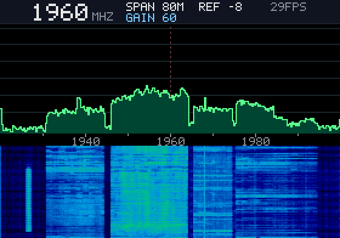
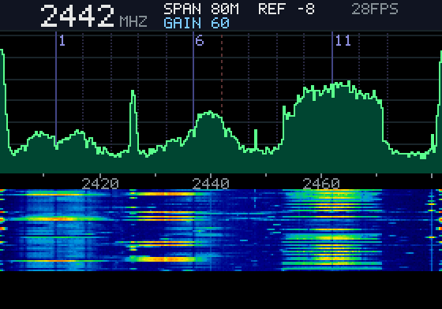
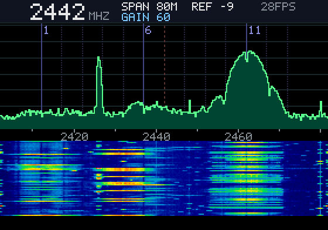
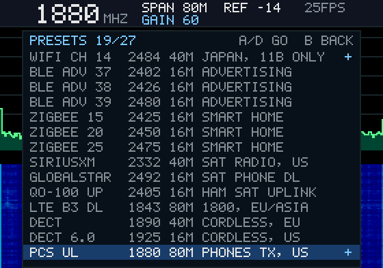

# ESP-SDR on Lilka

A pocket spectrum analyzer and waterfall for the [Lilka v2](https://github.com/lilka-dev/lilka)
(ESP32-S3), using the chip's own Wi-Fi radio as the receiver. No extra RF
hardware, and it runs straight from Keira's file manager.

| | |
| --- | --- |
|  |  |
|  |  |

It's a front end for [ESPARGOS/esp-sdr](https://github.com/ESPARGOS/esp-sdr).
ESP-SDR does the hard part: tuning, gain and raw I/Q snapshots through the
ESP32-S3's undocumented ADC-dump path. This project draws the result on the
Lilka's screen instead of sending it over USB.

## Install

1. Download `esp-sdr-lilka.bin` from the
   [latest release](https://github.com/dieron/esp-sdr-lilka/releases/latest).
2. Copy it to the Lilka's microSD card. You don't need a card reader: in
   Keira, open **Main menu → USB Drive** and press START, and the card shows
   up on your computer as a drive. Copy the file, eject the drive safely,
   then press A (Keira reboots).
3. In Keira, open **File Manager**, select `esp-sdr-lilka.bin` and press A.
   Keira's flash loader writes it into the second app slot and starts it.
4. To return to Keira, **hold SELECT for a second**. A reset also works.

Keira itself is never overwritten. The app doesn't touch Keira's settings
storage (NVS) either: it never initialises it, and Wi-Fi/PHY calibration
storage is turned off.

## What you see

* A **status bar**: frequency, span, gain, reference level, frames per second.
* A **spectrum** (65 dB tall), with Wi-Fi channel markers and peak hold.
* A **waterfall**: the newest row at the top, about 8 seconds of history.
* Tuning range **1840 to 2790 MHz**. It's most sensitive around 2.4 GHz,
  where the radio's filters are designed to work.
* Span **80, 40 or 16 MHz**. Each frame is one snapshot of 16,380 samples,
  averaged over 15 FFTs (Welch), at about 28 frames a second.
* Levels are uncalibrated dBFS. Use them to compare signals, not to measure
  them.
* The spike at the centre of the span (DC offset and LO leakage) is notched
  out. A signal sitting exactly on the centre frequency is hidden, so tune
  1 MHz off to see it.
* It only receives. Nothing is transmitted.

## Controls

| Button | Action |
| --- | --- |
| LEFT / RIGHT | Tune ±1 MHz. Hold to repeat; after a moment it steps 5 MHz at a time. |
| UP / DOWN | Reference level ±5 dB |
| A | Span 80 → 40 → 16 MHz |
| B | Gain: fixed 60 at start → 70 → 80 → AGC → 10 … 60 |
| C | Peak hold on/off |
| D | Preset list: UP/DOWN to move, LEFT/RIGHT to page, A or D to tune, B to close |
| START | Pause. With a PC listening, also saves a screenshot (see below). |
| SELECT | Hold 1 s: back to Keira. Tap: screenshot, which also works on the preset list. |

**Gain is fixed by default.** The radio's AGC is built for Wi-Fi packets and
changes gain on nearly every snapshot. That moves whole waterfall rows by up
to 20 dB and makes it look noisy. Changing the gain clears the waterfall,
and so does changing the frequency or the span.

## Presets

| Group | Presets |
| --- | --- |
| 2.4 GHz | ISM band (80 MHz span); Wi-Fi channels 1, 6, 11, 13 and 14; BLE advertising channels 37, 38 and 39; Zigbee 15, 20 and 25 |
| Satellite and ham | SiriusXM (2332), Globalstar downlink (2492), QO-100 uplink (2405) |
| Cordless | DECT EU (1890), DECT 6.0 US (1925) |
| Cellular, towers | LTE B3 1800 (1843), PCS 1900 (1960), LTE B1 2100 (2140), AWS B4/B66 (2160), LTE B7 2600 (2655) |
| Cellular, phones | PCS uplink (1880), B1 uplink (1950), B7 uplink (2535) |
| Cellular, TDD | LTE B40 (2350), 5G n41 (2600) |

Tower (downlink) bands are always on. Phone (uplink) bands only show bursts
while a phone nearby is transmitting.

Good first things to try:
* A **microwave oven** on the ISM preset.
* Your **Wi-Fi channel**.
* The **BLE advertising channels**: watch phones and tags blink.
* An **RC transmitter** hopping across 2.4 GHz.
* **Peak hold**, left on for a minute.

## Screenshots

Connect the Lilka over USB while the app runs, then start:

```
pip install pyserial
python tools/lilka_screenshot.py COM5          # or /dev/ttyACM0 on Linux
```

Pressing START (pause) saves the frozen frame as `lilka-sdr-<n>.png`, without
the PAUSED label; press START again to go on. A short tap of SELECT also saves
one, and works on the preset list too. After a change of frequency, span or
gain, wait about 10 seconds so the waterfall fills before you take a shot.
The app only sends screenshots while a PC is connected over USB.

## The bottom of the screen

The app draws on the top 196 rows and leaves the bottom 44 black. The Lilka
this was developed on has a panel that drops lines in that bottom strip,
and Keira's own demo apps show the same fault. If your panel is fine, build
with `-DLILKA_LCD_USED_HEIGHT=240` (or `.\build.ps1 -UsedHeight 240`) to use
the whole screen.

## Build from source

The firmware is ESP-SDR plus one patch:

* [ESPARGOS/esp-sdr](https://github.com/ESPARGOS/esp-sdr) at commit
  `89193f1190dd0f1f105e69bf29d2699ed8bf48a9`, plus
  [`patches/esp-sdr-lilka.patch`](patches/esp-sdr-lilka.patch).
* ESP-IDF at commit `25fe69f946311abdaf9ad56591f25fedbc20ac98` (6.2-dev),
  the version esp-sdr pins in its `firmware-targets.json`.

On Windows, `.\build.ps1` sets everything up in `C:\esp` and builds. It
avoids synced folders and long paths, both of which break the build. By
hand, on any OS:

```sh
git clone https://github.com/ESPARGOS/esp-sdr && cd esp-sdr
git checkout 89193f1190dd0f1f105e69bf29d2699ed8bf48a9
git submodule update --init --depth 1
git apply ../esp-sdr-lilka/patches/esp-sdr-lilka.patch
# with ESP-IDF 25fe69f9 installed and exported:
IDF_COMPONENT_MANAGER=0 idf.py -B build-lilka -DIDF_TARGET=esp32s3 \
  -DSDKCONFIG=build-lilka/sdkconfig \
  "-DSDKCONFIG_DEFAULTS=sdkconfig.defaults.esp32s3;sdkconfig.defaults.lilka" \
  -DESP_SDR_LILKA=ON build
# result: build-lilka/esp_sdr.bin
```

`src/` holds a copy of the new files so you can browse them; the patch is
the source of truth. The patch:

* **Adds `main/lilka/`, the on-device front end:**
  * a polling-SPI ST7789 driver, set up as Keira's Arduino_GFX does: 80 MHz,
    SPI mode 3, the same panel settings;
  * buttons with debounce and auto-repeat;
  * a 5×7 font;
  * the DSP, drawing and controls.
* **Changes `main/targets/esp32s3/receiver.c`:**
  * splits the snapshot capture out of the serial protocol code;
  * adds a small `sdr_*` API for the front end;
  * adds a Lilka `app_main` that never touches NVS.
* **Adds build switches** `ESP_SDR_LILKA` and `LILKA_LCD_USED_HEIGHT`, plus
  `sdkconfig.defaults.lilka`. That file sets 16 MB flash, because Keira's
  second app slot is at 0x650000, and turns off the NVS writes and the UART
  protocol.

## Notes

* **Built with ESP-IDF 6.2, booted by Keira's ESP-IDF 4.4 bootloader.** That
  works. The app image declares 16 MB flash and an ESP32-S3 of any revision.
* **The Lilka v2 switches display power on GPIO 46.** The app drives it high,
  as Keira does.
* **Retuning takes about 20 ms**, mostly recalibrating the receiver.
* **A button that's already pressed when the app starts is ignored** until
  it's released once.

## License and credits

GPL-3.0, like ESP-SDR, which this is built on (see [LICENSE](LICENSE)).
The RF capture work is ESPARGOS/esp-sdr's. The display init values come from
Arduino_GFX, as used by Keira. Lilka and Keira are by
[lilka-dev](https://github.com/lilka-dev).
